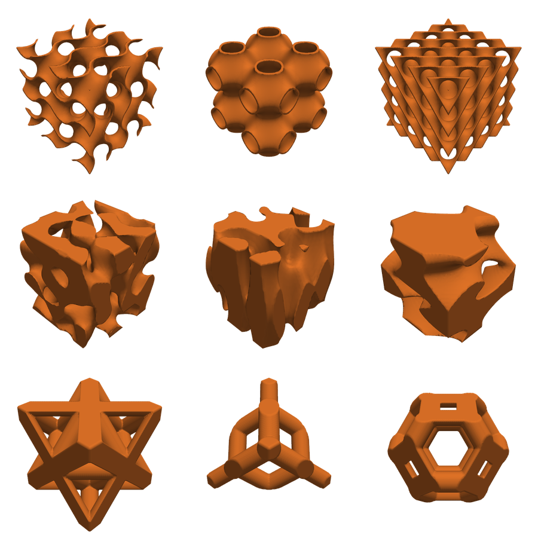
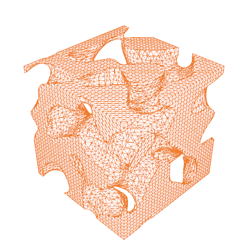

<p align="center">
    
</p>

**microgen** is a Python library designed to facilitate microstructure generation and meshing. Here are its core features:

- **Triply Periodic Minimal Surfaces (TPMS)**: gyroid, Schwarz, Schoen, Neovius, Fischer-Koch… as sheets or skeletons, graded in density, cell size or cell type, in Cartesian, cylindrical or spherical frames, and as infill of any mesh.
- **Spinodoids**: random, anisotropic bicontinuous microstructures from Gaussian random fields.
- **Lattices**: octet-truss, honeycomb, preset and custom (e.g. auxetic) strut lattices.
- **Virtual composites**: periodic RVEs of spheres, short fibres, ellipsoids and other inclusions.
- **3D Voronoi tessellation**: granular materials and polycrystalline metals, also combined with TPMS.
- **Implicit workflow**: shapes as implicit fields (F-rep), with boolean operations and blending.
- **Meshing**: regular and **periodic** meshing using Gmsh, level-set **remeshing** using Mmg.

Generation of 3D objects is achievable through functions that utilize Open CASCADE (via [cadquery-ocp-novtk](https://github.com/CadQuery/ocp-build-system), the direct OCCT Python binding) or VTK (using PyVista). Neper offers tools for 3D tessellation, while Gmsh handles the generation of both regular and periodic meshes, with Mmg handling remeshing tasks.

The CAD path (`.generate_cad()` on shapes, `Phase`, `fuse_shapes`, periodic split, lattice CAD) is **optional** — install with `pip install 'microgen[cad]'`. The default `pip install microgen` gives you mesh + implicit-field (F-rep) workflows only, which is sufficient for many applications and has a much lighter dependency footprint (no OCCT, no VTK version pin).

<p align="center">
    <a href="https://3mah.github.io/microgen-docs/examples/index.html"></a>
    <a href="https://3mah.github.io/microgen-docs/examples/Spinodoids/spinodoid.html"></a>
</p>

## Hello, gyroid (implicit-first, no CAD needed)

```python
from microgen import Phase, Tpms, surface_functions

gyroid = Tpms(surface_function=surface_functions.gyroid, offset=0.3)
phase  = Phase.from_shape(gyroid, resolution=80)

phase.surface_mesh().save("gyroid.stl")  # marching cubes from the SDF
print(f"COM = {phase.center_of_mass}, pieces = {len(phase.pieces)}")
```

A `Phase` built via `Phase.from_shape` carries the implicit field directly —
marching cubes, connected components (`phase.pieces`), and grid-quadrature
moments all run from the SDF, no OCCT required. CAD (`phase.cad`, STEP export,
gmsh `setPeriodic`) is materialised lazily and only needs the `[cad]` extra.

|        |            |
| -------------- | ---------------- |
| PyPI package   | [](https://pypi.org/project/microgen/) |
| Conda forge package  | [](https://anaconda.org/conda-forge/microgen) |
| Documentation  | [](https://3mah.github.io/microgen-docs/) |
| Status         | [](https://github.com/3MAH/microgen) |
| Citation       | [](https://doi.org/10.5281/zenodo.6793573) |
| License        | [](https://www.gnu.org/licenses/gpl-3.0) |
| Website        | [](https://3mah.github.io/) |

## Installation

**Core (mesh + implicit-field / F-rep, no CAD kernel)** — lighter, works with VTK 9.4+:

```bash
pip install microgen
```

**With CAD capabilities** (OCCT via `cadquery-ocp-novtk`, enables `.generate_cad()`, `Phase`, `fuse_shapes`, periodic split, lattice CAD):

```bash
pip install 'microgen[cad]'
```

With conda:

```bash
conda install conda-forge::microgen          # core
conda install conda-forge::microgen ocp      # core + CAD
```

**Python version notes:** Python 3.11 to 3.14 is supported on Linux, macOS (Apple Silicon), and Windows, for both core and `[cad]`, on both PyPI and conda-forge.

What you can do in each mode:

|                                       | Core install | `[cad]` install |
| ------------------------------------- | :----------: | :-------------: |
| `Shape.generate_surface_mesh()` (viz) |      ✅      |        ✅        |
| Implicit fields, TPMS F-rep, booleans |      ✅      |        ✅        |
| `Shape.generate_cad()` (OCCT BREP)        |      ❌      |        ✅        |
| `Phase`, `fuse_shapes`, `cut_*`       |      ❌      |        ✅        |
| Periodic split, lattice CAD export    |      ❌      |        ✅        |
| VTK 9.4+                              |      ✅      |        ✅        |

-------------------------------------------------------------------------------------------------------

To modify the sources, clone this repository and install microgen:

```bash
git clone https://github.com/3MAH/microgen.git
cd microgen
pip install -e .[all]
pre-commit install
```

The `-e` or `--editable` option allows to modify the sources without having to reinstall the package and `[all]` installs the optional development dependencies.


Run tests with pytest:

```bash
pytest tests -n auto
```

## Examples

Click on an image to open the example in the [gallery](https://3mah.github.io/microgen-docs/examples/index.html) of **microgen**'s documentation. The images are rendered by the documentation build, so they always show the current version of each example.

### Triply Periodic Minimal Surfaces (TPMS)

<p>
<a href="https://3mah.github.io/microgen-docs/examples/TPMS/tpms_surfaces.html"></a>
<a href="https://3mah.github.io/microgen-docs/examples/TPMS/gyroid.html"></a>
<a href="https://3mah.github.io/microgen-docs/examples/TPMS/fischer_koch_s.html"></a>
<a href="https://3mah.github.io/microgen-docs/examples/TPMS/tpms_shell.html"></a>
<a href="https://3mah.github.io/microgen-docs/examples/TPMS/tpms_sphere.html"></a>
</p>

### Graded TPMS

<p>
<a href="https://3mah.github.io/microgen-docs/examples/TPMS/graded_density.html"></a>
<a href="https://3mah.github.io/microgen-docs/examples/TPMS/graded_cell_size.html"></a>
<a href="https://3mah.github.io/microgen-docs/examples/TPMS/graded_cell_type.html"></a>
</p>

### Cylindrical and spherical TPMS

<p>
<a href="https://3mah.github.io/microgen-docs/examples/TPMS/cylindrical.html"></a>
<a href="https://3mah.github.io/microgen-docs/examples/TPMS/cylindrical_graded.html"></a>
<a href="https://3mah.github.io/microgen-docs/examples/TPMS/spherical.html"></a>
<a href="https://3mah.github.io/microgen-docs/examples/TPMS/coordinate_frames.html"></a>
</p>

### TPMS infill

<p>
<a href="https://3mah.github.io/microgen-docs/examples/TPMS/infill_bunny.html"></a>
<a href="https://3mah.github.io/microgen-docs/examples/TPMS/infill_graded_distance.html"></a>
<a href="https://3mah.github.io/microgen-docs/examples/TPMS/infill_gyroid.html"></a>
</p>

### Spinodoids

<p>
<a href="https://3mah.github.io/microgen-docs/examples/Spinodoids/spinodoid.html"></a>
</p>

### Lattices

<p>
<a href="https://3mah.github.io/microgen-docs/examples/Lattices/octet_truss.html"></a>
<a href="https://3mah.github.io/microgen-docs/examples/Lattices/honeycomb.html"></a>
<a href="https://3mah.github.io/microgen-docs/examples/Lattices/preset_lattices.html"></a>
<a href="https://3mah.github.io/microgen-docs/examples/Lattices/custom_auxetic_lattice.html"></a>
</p>

### Particle and fibre RVEs

<p>
<a href="https://3mah.github.io/microgen-docs/examples/RVE/spheres_rve.html"></a>
<a href="https://3mah.github.io/microgen-docs/examples/RVE/fibres_rve.html"></a>
<a href="https://3mah.github.io/microgen-docs/examples/Fibers/fibers.html"></a>
</p>

### Implicit workflow

<p>
<a href="https://3mah.github.io/microgen-docs/examples/ImplicitShapes/gyroid_implicit_phase.html"></a>
<a href="https://3mah.github.io/microgen-docs/examples/ImplicitShapes/implicit_booleans.html"></a>
</p>

### Basic shapes and 3D operations

<p>
<a href="https://3mah.github.io/microgen-docs/examples/BasicShapes/shapes.html"></a>
<a href="https://3mah.github.io/microgen-docs/examples/BasicShapes/platonic_solids.html"></a>
<a href="https://3mah.github.io/microgen-docs/examples/3Doperations/repeat_shape.html"></a>
<a href="https://3mah.github.io/microgen-docs/examples/3Doperations/raster_ellipsoid.html"></a>
<a href="https://3mah.github.io/microgen-docs/examples/3Doperations/voronoi.html"></a>
<a href="https://3mah.github.io/microgen-docs/examples/3Doperations/voronoi_gyroid.html"></a>
</p>

### Meshing and remeshing

<p>
<a href="https://3mah.github.io/microgen-docs/examples/Mesh/periodic_gyroid_remesh.html"></a>
<a href="https://3mah.github.io/microgen-docs/examples/Mesh/remesh.html"></a>
<a href="https://3mah.github.io/microgen-docs/examples/Mesh/mmg3d.html"></a>
<a href="https://3mah.github.io/microgen-docs/examples/Mesh/mmg_voronoi.html"></a>
</p>

## Citation

If you use **microgen** in academic work, please cite it using the concept DOI, which always resolves to the latest archived version on Zenodo:

> [10.5281/zenodo.6793573](https://doi.org/10.5281/zenodo.6793573)

A BibTeX entry suitable for the latest release:

```bibtex
@software{microgen,
  author    = {Marchais, Kevin and
               Chemisky, Yves and
               Legerstee, Yasmin and
               Guevara Garban, Manuel Ricardo},
  title     = {{microgen: microstructure generation and meshing}},
  publisher = {Zenodo},
  doi       = {10.5281/zenodo.6793573},
  url       = {https://doi.org/10.5281/zenodo.6793573}
}
```

To cite a specific release instead of the concept, follow the concept DOI to its Zenodo page and pick the version DOI for the release you used. Machine-readable metadata is also available in [`CITATION.cff`](CITATION.cff).

## Authors and contributors

**microgen** is developed by the [3MAH](https://3mah.github.io/) group and external collaborators.

**Authors**

- Kevin Marchais
- Yves Chemisky
- Yasmin Legerstee
- Manuel Ricardo Guevara Garban

**Contributors**

- Louise Le Barbenchon
- Karim Haffar
- Romain d'Esparbès
- Sudeep Kumar Sahoo
