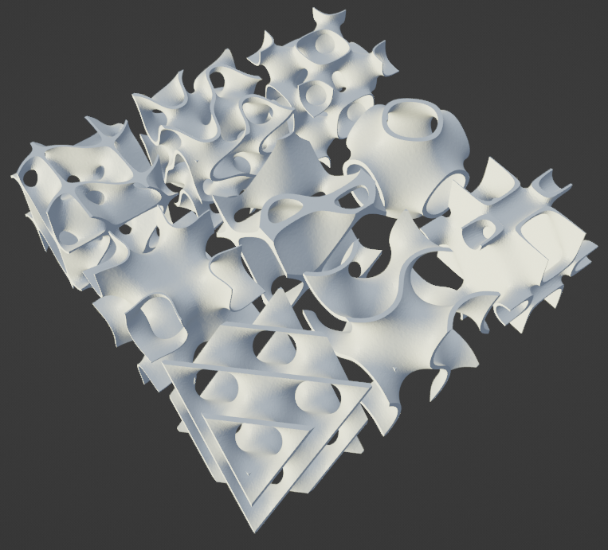
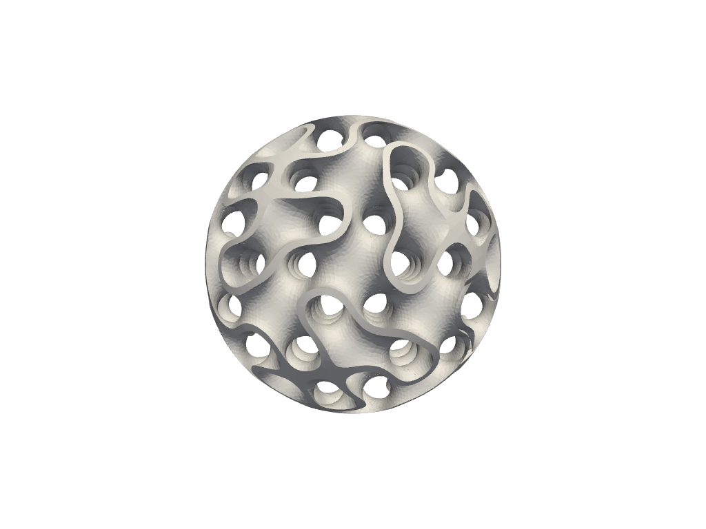

.. _RST Tpms:

Triply Periodic Minimal Surfaces (TPMS)
=======================================

Gyroid
--------------

.. include:: ../../examples/TPMS/gyroid/gyroid.py
   :literal:

.. image:: ../_static/examples/gyroid.png

Volume meshes with Meshers
-------------------------

Install the optional backend with ``pip install 'microgen[meshers]'``.
These examples export tetrahedral volume meshes as VTU files, retaining
periodic node pairs and boundary facets.

The uniform Gyroid unit cell is periodic along all three axes:

.. literalinclude:: ../../examples/TPMS/meshers/gyroid.py
   :language: python

A pointwise callable can grade the thickness offset. This example varies
the offset along z, so only x and y remain periodic. A linear offset does
not imply a linear density gradient. The callable must use operations
supported by the Meshers expression compiler to use compiled evaluation.

.. literalinclude:: ../../examples/TPMS/meshers/graded_gyroid.py
   :language: python

Sampled and mapped TPMS
~~~~~~~~~~~~~~~~~~~~~~

The extended backend also accepts offset arrays and ``OffsetGrading`` objects.
Their values are frozen on the original grid, including any normalization.
Tensor grids use trilinear interpolation with linear extrapolation. Clipped
grids use simplex interpolation with nearest-sample extension outside the
sample hull. These paths use NumPy callbacks. ``grading.as_field(grid)``
requires an explicit reference grid for the same reason.

Cylindrical and spherical patches use their original parameter fields and
coordinate maps. Full angular turns are welded at the seam; sector periodicity
exports a rigid ``periodic_transform_*`` matrix instead of a constant shift.
Parameter coordinates and named constraint masks are retained in the VTU file.
Mapped meshes currently require Tet4 and one thread; adaptive options belong
to the Cartesian field route. Spherical domains containing poles or the origin
and cylindrical domains touching their axis are rejected.

``Infill`` and ``GradedInfill`` retain the input object's signed-distance
envelope, which must be closed and manifold. Swept annuli require
``0 < radial_min < radial_max`` and an open regular curve. The forward and
inverse curve maps use the same interpolated frames. ``adapt=True`` uses the
Cartesian field route for sweeps, without mapped periodic ends. Closed curves
and collapsed axes remain unsupported. Quality failures propagate without
changing the requested threshold or falling back to VTK/MMG.
An annular Gyroid sweep has not yet passed the retained quality/resource
controls: mapped attempts reached minimum quality 0.0284 and 0.0493, and the
strict adaptive attempt exceeded 250,000 tetrahedra. Domain-map support is
tested separately; these results do not establish general sweep readiness.

.. literalinclude:: ../../examples/TPMS/meshers/extended_tpms.py
   :language: python

TPMS available
--------------

.. include:: ../../examples/TPMS/tpms/tpms.py
   :literal:

Spherical gyroid
-----------------------

.. include:: ../../examples/TPMS/tpmsSphere/tpmsSphere.py
   :literal:

Shell
---------

.. include:: ../../examples/TPMS/tpmsShell/tpmsShell.py
   :literal:

.. image:: ../_static/examples/tpms_shell.png
