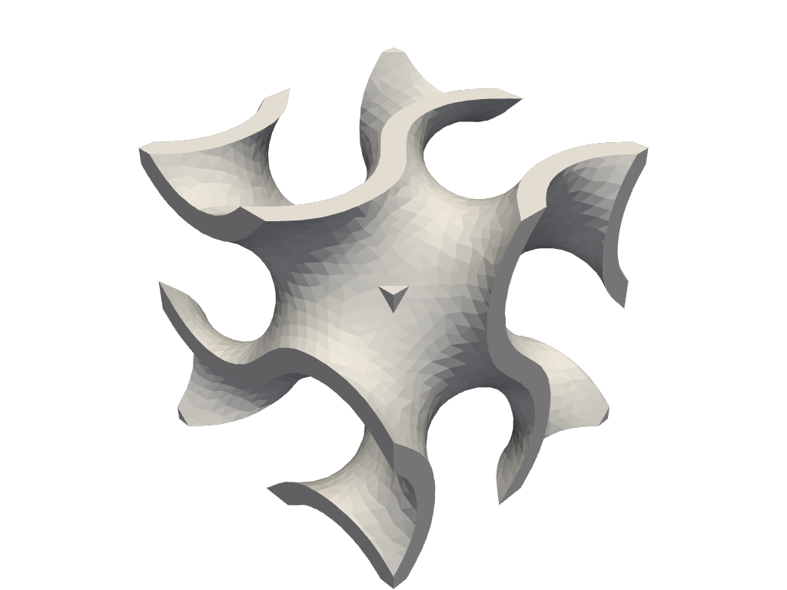
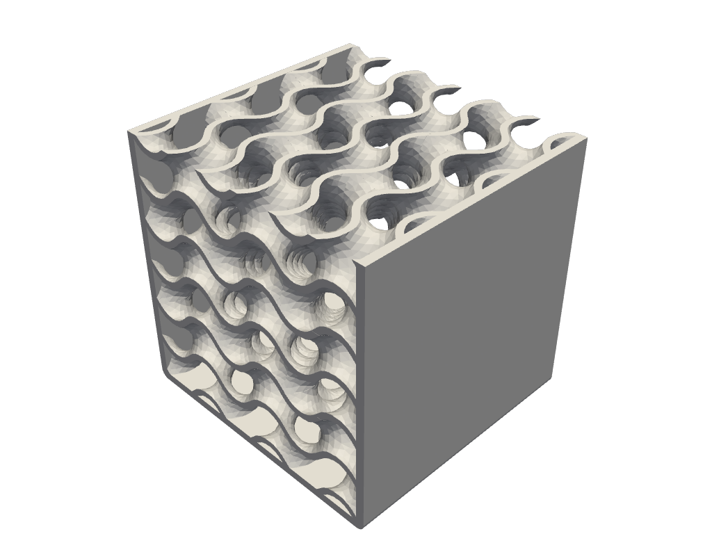

.. _RST Tpms:

Triply Periodic Minimal Surfaces (TPMS)
=======================================

Gyroid
--------------

.. include:: ../../examples/TPMS/gyroid/gyroid.py
   :literal:

Volume meshes with Meshers
-------------------------

Install the optional backend with ``pip install 'microgen[meshers]'``.
These examples export tetrahedral volume meshes as VTU files, retaining
periodic node pairs and boundary facets.

The uniform Gyroid unit cell is periodic along all three axes:

.. literalinclude:: ../../examples/TPMS/meshers/gyroid.py
   :language: python

A pointwise callable can grade the thickness offset. This example varies
the offset along z, so only x and y remain periodic. A linear offset does
not imply a linear density gradient. The callable must use operations
supported by the Meshers expression compiler; sampled arrays and
``OffsetGrading`` objects are not supported by this backend.

.. literalinclude:: ../../examples/TPMS/meshers/graded_gyroid.py
   :language: python

TPMS available
--------------

.. include:: ../../examples/TPMS/tpms/tpms.py
   :literal:

.. image:: ../_static/examples/tpms.png

Spherical gyroid
-----------------------

.. include:: ../../examples/TPMS/tpmsSphere/tpmsSphere.py
   :literal:

.. image:: ../_static/examples/tpms_sphere.png

Shell
---------

.. include:: ../../examples/TPMS/tpmsShell/tpmsShell.py
   :literal:

