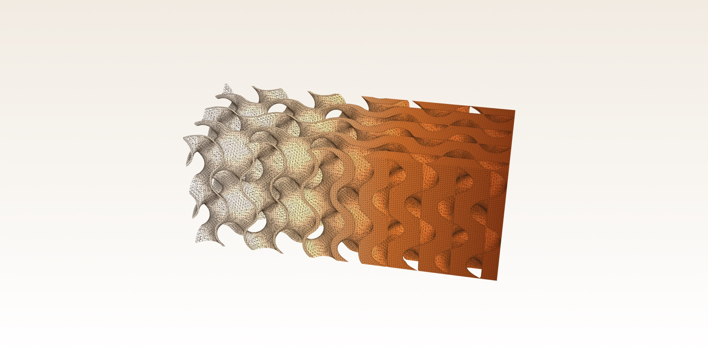

microgen
========

.. rst-class:: mg-tagline

   Microstructure generation and periodic meshing for the mechanics of
   architectured materials.

**microgen** generates triply periodic minimal surfaces, strut lattices,
Voronoi polycrystals and composite inclusions as implicit fields or CAD
solids, and meshes them with conforming, periodic tetrahedral meshes ready
for homogenization with `fedoo <https://3mah.github.io/fedoo-docs/>`_ and
`simcoon <https://3mah.github.io/simcoon-docs/>`_.

.. container:: mg-buttons

   .. button-ref:: RST QuickStart
      :color: primary
      :shadow:

      Get started

   .. button-ref:: examples
      :color: primary
      :outline:

      Gallery of examples

   .. button-ref:: RST Doc
      :color: secondary
      :outline:

      API reference

   .. button-link:: https://github.com/3MAH/microgen
      :color: secondary
      :outline:

      GitHub

What you can build
------------------

.. grid:: 1 2 3 3
   :gutter: 3

   .. grid-item-card:: Triply periodic minimal surfaces
      :img-top: examples/TPMS/images/thumb/sphx_glr_tpms_surfaces_thumb.png
      :link: sphx_glr_examples_TPMS_tpms_surfaces.py
      :link-type: ref
      :class-card: mg-card

      Gyroid, Schwarz, Schoen, Neovius, Fischer-Koch and more, as sheets or
      skeletals, at a prescribed density.

   .. grid-item-card:: Grading and morphing
      :img-top: examples/TPMS/images/thumb/sphx_glr_graded_cell_type_thumb.png
      :link: sphx_glr_examples_TPMS_graded_density.py
      :link-type: ref
      :class-card: mg-card

      Density and cell-size gradients, morphing between TPMS families,
      cylindrical, spherical and swept frames.

   .. grid-item-card:: Spinodoids
      :img-top: examples/Spinodoids/images/thumb/sphx_glr_spinodoid_thumb.png
      :link: sphx_glr_examples_Spinodoids_spinodoid.py
      :link-type: ref
      :class-card: mg-card

      Periodic Gaussian random fields at a prescribed density, isotropic,
      columnar or lamellar.

   .. grid-item-card:: Strut lattices
      :img-top: examples/Lattices/images/thumb/sphx_glr_custom_auxetic_lattice_thumb.png
      :link: sphx_glr_examples_Lattices_preset_lattices.py
      :link-type: ref
      :class-card: mg-card

      Twelve preset lattices, custom and auxetic cells, octet-truss and
      honeycomb.

   .. grid-item-card:: Voronoi polycrystals
      :img-top: examples/3Doperations/images/thumb/sphx_glr_voronoi_thumb.png
      :link: sphx_glr_examples_3Doperations_voronoi.py
      :link-type: ref
      :class-card: mg-card

      Neper tessellations as polyhedral grains, alone or intersected with a
      TPMS.

   .. grid-item-card:: Particle and fibre RVEs
      :img-top: examples/RVE/images/thumb/sphx_glr_fibres_rve_thumb.png
      :link: sphx_glr_examples_RVE_fibres_rve.py
      :link-type: ref
      :class-card: mg-card

      Random, non-overlapping spheres and short fibres with their periodic
      images.

   .. grid-item-card:: Periodic meshes
      :img-top: examples/Lattices/images/thumb/sphx_glr_octet_truss_thumb.png
      :link: sphx_glr_examples_Lattices_octet_truss.py
      :link-type: ref
      :class-card: mg-card

      Conforming tetrahedral meshes with matching nodes on opposite faces
      (gmsh), remeshing with mmg.

   .. grid-item-card:: Implicit booleans
      :img-top: examples/ImplicitShapes/images/thumb/sphx_glr_implicit_booleans_thumb.png
      :link: sphx_glr_examples_ImplicitShapes_implicit_booleans.py
      :link-type: ref
      :class-card: mg-card

      Every shape is a signed field: union, intersection, difference and
      smooth blends are instant, robust and need no CAD kernel.

   .. grid-item-card:: Measured microstructures
      :img-top: examples/Fibers/images/thumb/sphx_glr_fibers_thumb.png
      :link: sphx_glr_examples_Fibers_fibers.py
      :link-type: ref
      :class-card: mg-card

      15 000 fibres rebuilt from a tomography analysis of a short fibre
      composite.

Hello, gyroid
-------------

.. code-block:: python

   from microgen import Phase, Tpms, surface_functions

   gyroid = Tpms(surface_function=surface_functions.gyroid, offset=0.3)
   phase = Phase.from_shape(gyroid, resolution=80)

   phase.surface_mesh().save("gyroid.stl")  # marching cubes from the field
   print(f"COM = {phase.center_of_mass}, pieces = {len(phase.pieces)}")

A :class:`~microgen.Phase` built with :meth:`~microgen.Phase.from_shape`
carries the implicit field: marching cubes, connected components and moments
are computed from the field, without the CAD backend. The CAD representation
(STEP export, periodic gmsh meshes) is built on demand and needs the
``[cad]`` extra.

Install
-------

.. tab-set::

   .. tab-item:: pip

      .. code-block:: bash

         pip install microgen            # implicit fields and surface meshes
         pip install "microgen[cad]"     # + OCCT: CAD export, periodic meshes

   .. tab-item:: conda

      .. code-block:: bash

         conda install -c conda-forge microgen        # core
         conda install -c conda-forge microgen ocp    # core + CAD

See :ref:`RST Install` for the details of each mode.

The 3MAH ecosystem
------------------

.. grid:: 1 1 3 3
   :gutter: 3

   .. grid-item-card:: microgen
      :class-card: mg-card mg-card--current

      Geometry and periodic meshes of microstructures.

   .. grid-item-card:: fedoo
      :link: https://3mah.github.io/fedoo-docs/
      :class-card: mg-card

      Nonlinear finite elements and periodic homogenization.

   .. grid-item-card:: simcoon
      :link: https://3mah.github.io/simcoon-docs/
      :class-card: mg-card

      Constitutive laws and mean-field micromechanics.

Cite microgen
-------------

If you use microgen in academic work, please cite the concept DOI
`10.5281/zenodo.6793573 <https://doi.org/10.5281/zenodo.6793573>`_, which
always resolves to the latest release. microgen is developed by the
`3MAH <https://3mah.github.io/>`_ group and external collaborators, under the
GPL-3.0 license.

.. toctree::
   :hidden:
   :maxdepth: 1
   :caption: Getting started

   Overview
   Install
   quick_start
   tutorials

.. toctree::
   :hidden:
   :maxdepth: 2
   :caption: Examples

   examples/index
   meshers_backend

.. toctree::
   :hidden:
   :maxdepth: 1
   :caption: Reference

   Documentation
   changelog
